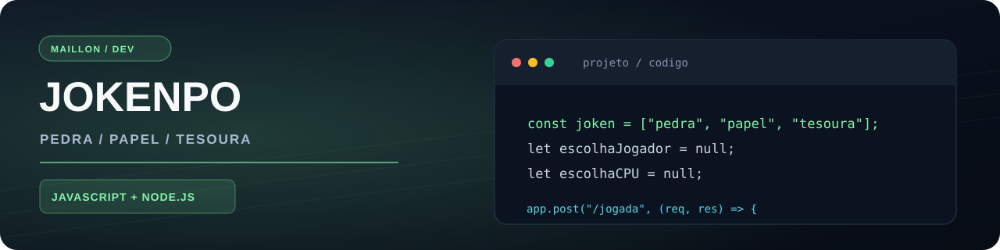
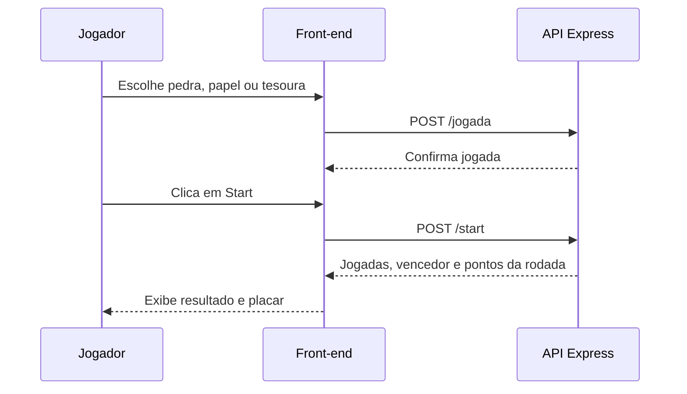

<p align="center"></p>
# JoKenPo com API
   

> Jogo de Pedra, Papel e Tesoura contra a CPU, com interface web e processamento das rodadas em uma API Node.js com Express.

🎮 **[Jogar agora](https://maillon49-prog.github.io/Jogo-de-JoKemPo-com-API/)** · 💻 **[Ver código](https://github.com/maillon49-prog/Jogo-de-JoKemPo-com-API)**

## 🎮 Como jogar
1. Escolha **Pedra**, **Papel** ou **Tesoura**.
2. Clique em **Start** para a API sortear a jogada da CPU.
3. Veja o resultado e a pontuação da rodada.
4. Clique em **Revanche** para jogar novamente.

## ✨ Funcionalidades atuais
- 🪨 📄 ✂️ Três opções de jogada
- 🎲 Escolha aleatória da CPU
- 🏆 Resultado de vitória, derrota ou empate
- 📊 Placar mostrado durante a execução da página
- 🔁 Revanche sem recarregar a tela
- 🌐 Front-end no GitHub Pages e API hospedada no Render
- 🛡️ Respostas HTTP de sucesso e erro (`200`, `400` e `500`)

## 🛠️ Tecnologias
| Front-end | Back-end | Hospedagem |
| :-- | :-- | :-- |
| HTML, CSS, JavaScript e `fetch` | Node.js, Express e CORS | GitHub Pages + Render |

## 🧭 Arquitetura atual


## 🔌 Endpoints da API
| Método | Rota | Função |
| :-- | :-- | :-- |
| `POST` | `/jogada` | Recebe a escolha do jogador |
| `POST` | `/start` | Sorteia a CPU e calcula o resultado |

Exemplo de corpo enviado para `/jogada` (`0` = pedra, `1` = papel, `2` = tesoura):
```json
{ "jogada": 0 }
```

Exemplo de resposta de `/start` para uma vitória do jogador:
```json
{
  "jogador": "pedra",
  "CPU": "tesoura",
  "vencedor": "Jogador vencel!",
  "victoryJogador": 1,
  "victoryCPU": 0
}
```

> O texto do campo `vencedor` acima reproduz o retorno atual do código. A API devolve **pontos da rodada**, não um placar acumulado por usuário.

## 🚀 Executar localmente
**Requisitos:** Node.js e npm.
```bash
git clone https://github.com/maillon49-prog/Jogo-de-JoKemPo-com-API.git
cd Jogo-de-JoKemPo-com-API/backend
npm install
npm start
```

Abra o `index.html` na raiz do projeto no navegador. Atualmente, o `logica.js` está configurado para utilizar a URL pública da API no Render. Para apontar para a API local, substitua a URL das requisições por `http://localhost:3000`.

## 📁 Estrutura
```text
Jogo-de-JoKemPo-com-API/
├── backend/        # API, package.json e dependências
├── img/            # Imagens das jogadas
├── index.html      # Interface do jogo
├── estilos.css     # Estilos
├── main.js         # Eventos dos botões
└── logica.js       # Requisições e lógica do front-end
```

## 🗺️ Futuras atualizações
- [ ] **Multijogador**, com partidas independentes entre usuários
- [ ] Persistência de placares por navegador

> **Observação técnica:** nesta versão, a API armazena a escolha da jogada em uma variável compartilhada no servidor. Isso atende ao protótipo individual, mas precisa ser alterado antes de oferecer partidas simultâneas para várias pessoas.

## 🎯 O que pratiquei
Criação de APIs com Express, comunicação assíncrona com `fetch`, validação de requisições, status HTTP, manipulação do DOM e integração entre serviços publicados.

---

### 👨‍💻 Autor

Desenvolvido por **Maillon Andrade de Oliveira**, como parte dos meus estudos e projetos práticos de programação.

[GitHub](https://github.com/maillon49-prog) · [Portfólio](https://github.com/maillon49-prog/Portifolio)
